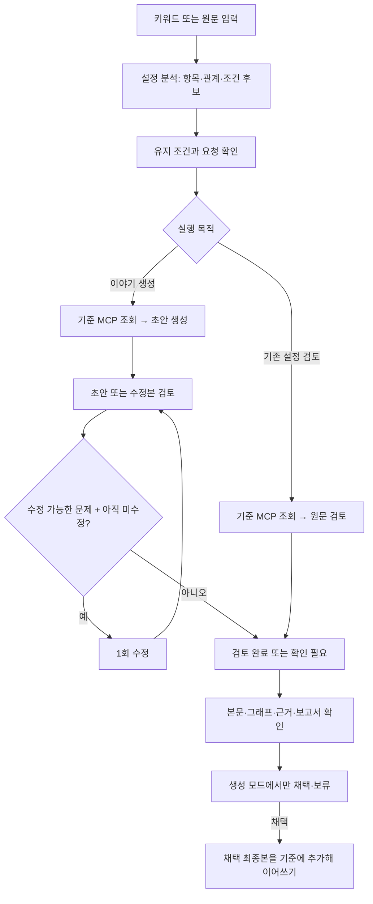
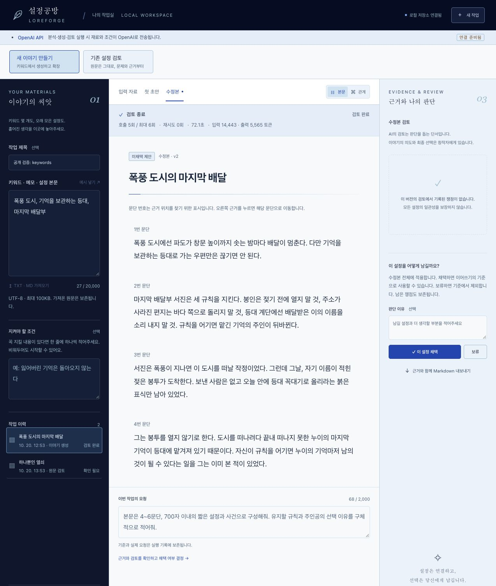
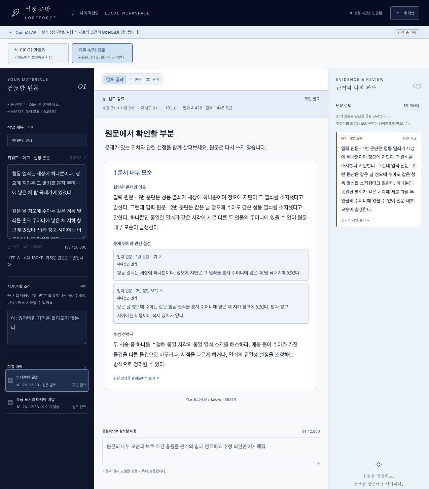
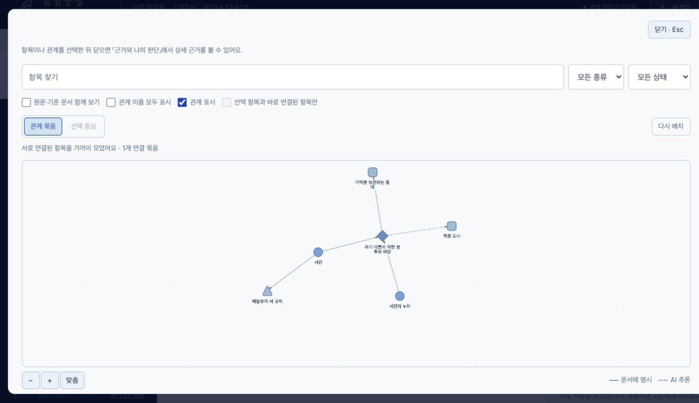

# G074 김지민 · 설정공방 LoreForge 결과보고서

**선택 과제: 과제 2 — AI 서비스 개발**

**주제: 키워드로 세계관을 만들고, 기존 원고의 설정 충돌을 근거와 함께 검토하는 웹 서비스**

작성일: 2026-10-21

## 1. 진행 사항 소개

### 기획 배경과 목표

게임·소설·웹툰의 설정이 늘어나면 인물의 행동, 사건 순서, 세계관 규칙을 반복해서 대조해야 한다. AI로 내용을 확장할 수는 있지만, 긴 결과를 처음부터 다시 읽으며 무엇이 바뀌었고 어떤 설정과 부딪히는지 확인하는 부담이 남는다.

LoreForge는 이 문제를 **이야기 생성**과 **기존 설정 검토**로 나누어 해결하고자 했다. 키워드만 있는 경우에는 첫 설정을 만들고, 이미 원고가 있는 경우에는 전체 재작성보다 문제 위치·관련 설정·이유·수정 선택지를 먼저 보여준다. 본문과 관계 그래프를 같은 데이터로 연결하고, AI의 제안과 창작자가 채택한 설정을 구분했다.

수업 Base의 실행·통신 구조를 참고해 별도 저장소에 구현했다. 특정 작품을 전제로 하지 않으며, 자유 텍스트와 UTF-8 TXT·MD를 입력으로 받는다.

### 주요 task와 구현 결과

| 주요 task | 구현한 내용 | 결과 확인 방법 |
|---|---|---|
| 키워드 기반 설정 생성 | 설정 분석 → 초안 생성 → 검토 → 필요 시 최대 1회 수정·재검토 | 본문에서 입력·첫 초안·수정본을 전환 |
| 원문 검토 전용 흐름 | 생성 담당을 실행하지 않고 원문의 문제·근거·수정 선택지를 반환 | 검토 결과에서 관련 문단으로 이동 |
| 과도한 지적 보완 | 원문 전체의 설명·예외·배타적 선택지를 먼저 대조 | 해소된 후보와 선택적 상세화를 문제 목록에서 제외 |
| 설정 관계 탐색 | 인물·세력·장소·사건·규칙을 그래프로 표시 | 항목·관계 선택 → 설명과 근거 문단 확인 |
| 선택에 따른 확장 | 채택한 최종 문서만 다음 실행의 기준에 추가 | 채택 후 이어쓰기, 보류 시 이어쓰기 제외 |
| 실행·저장 안정화 | 호출 예산, 중복 요청 방지, 진행 알림, SQLite 저장·복원 | 호출·토큰·시간·상태 확인, 새로고침 후 결과 복원 |

### 사용 중 발견한 문제와 개선

| 발견한 문제 | 반영한 개선 |
|---|---|
| `제안 p001`처럼 내부 식별자가 노출되어 위치를 이해하기 어려웠다. | `수정본 · 1번 문단`처럼 문서 버전과 읽기 순서를 표시했다. 내부 근거 ID는 유지했다. |
| 설정 본문에 “검토용 제안본이다”, “이야기의 시작은 변하지 않는다” 같은 작업 설명이 섞였다. | 생성·수정 프롬프트를 보완하고, 제안 상태 안내는 화면에서 별도로 표시했다. |
| 검토를 받으려면 긴 이야기가 다시 생성되어 전체를 읽어야 했다. | 생성과 검토 목적 탭을 나누고, 원문을 재작성하지 않는 검토 흐름을 추가했다. |
| 원문에 이미 설명한 내용을 설명 부족으로 지적했다. | 지적 후보에 대한 해소 근거·예외·적용 범위를 확인하도록 출력 계약과 서버 검증을 보완했다. |
| 다른 문서의 같은 이름이 중복처럼 보이고 관계도 라벨이 겹쳤다. | 현재 문서를 기본 범위로 삼고, 관계 묶음·선택 중심 배치와 크게 보기를 추가했다. |
| 긴 글을 읽기에 색상과 본문 밀도가 부담스러웠다. | 네이비·블루와 밝은 본문 영역으로 변경하고 본문 크기·줄 간격·읽기 폭을 조정했다. |

## 2. 사용한 기술 요소

### 기술 구성과 적용 범위

| 기술 요소 | 적용 내용 | 주요 코드 |
|---|---|---|
| **Multi-Agent · LangGraph** | 설정 분석·창작·검토의 역할과 출력 계약을 분리했다. 분석 후 생성/검토 목적에 따라 실행 경로를 선택하고, 수정 가능한 문제와 수정 이력으로 다음 단계를 판단한다. | [workflow.py](backend/workflow.py), [provider.py](backend/provider.py) |
| **MCP** | 실제 stdio 연결로 읽기 전용 `get_passages` 도구를 호출한다. 실행 당시 기준 버전과 문단 ID를 확인하고 조회 결과를 스냅샷과 대조한다. | [mcp_client.py](backend/mcp_client.py), [mcp_server.py](backend/mcp_server.py) |
| **구조화 출력 · Pydantic** | 본문·항목·관계·근거를 JSON 계약으로 검증한다. 잘못된 문서 참조나 관계 끝점을 확인하고, 본문·그래프·Markdown에 같은 데이터를 사용한다. | [models.py](backend/models.py), [documents.py](backend/documents.py) |
| **의존성 주입** | `create_app(db_path, provider)`와 `build_workflow(store, provider)`에 저장소·모델 제공자를 전달한다. 테스트에서는 임시 DB와 가짜 제공자로 교체한다. | [main.py](backend/main.py), [test_backend.py](tests/test_backend.py) |
| **LangSmith** | 선택한 공개 입력 실행의 역할·모델 호출·수정 분기·MCP·사용량을 추적한다. 원문·프롬프트·출력 본문은 전송하지 않는다. | [tracing.py](backend/tracing.py), [verify_trace.py](scripts/verify_trace.py) |
| **모듈화** | API, 워크플로, 모델 호출, 문서 검증, 저장, MCP, 추적을 분리했다. 프런트엔드는 API 통신과 그래프 컴포넌트·배치 로직을 분리했다. | [backend/](backend/), [api.ts](frontend/src/api.ts), [graph-layout.ts](frontend/src/graph-layout.ts) |
| **단위·통합 테스트** | 근거 검증, 수정·재시도 상한, 원문 보존, 채택 기준, 중복 요청, 검토 전용 경로와 그래프 배치를 검사한다. | [tests/](tests/), [frontend/tests/](frontend/tests/) |
| **SQLite · SSE** | 실행 데이터와 진행 이벤트를 저장하고 화면에 단계 변화를 전달한다. 새로고침과 SSE 재연결은 추가 모델 호출을 만들지 않는다. | [store.py](backend/store.py), [main.py](backend/main.py) |
| **RAG** | **이번 MVP에는 적용하지 않았다.** 20,000자 이내의 기준 전체를 제공한다. MCP 조회는 버전·ID에 따른 문단 재조회이며 벡터 검색이 아니다. | [입력·기준 검증](backend/main.py) |

프런트엔드는 **Vue 3·TypeScript·Vite·Cytoscape.js**, 백엔드는 **Python·FastAPI·Pydantic·SQLite**로 구성했다. AI는 **OpenAI Responses API**를 사용하며 기본 모델은 설정 분석 `gpt-5.4-mini`, 창작·검토 `gpt-5.4`다. 역할별 환경변수로 모델을 변경하고 실제 응답 모델과 프롬프트 버전을 기록한다.

여기서 Multi-Agent는 역할별 프롬프트와 출력 계약을 나눈 **순차 실행 구조**다. 에이전트가 자율적으로 회의하거나 병렬 토론하는 구조는 아니다. 창작과 검토에 같은 모델을 사용하므로 역할 분리만으로 검토의 독립적인 정확성이 보장되지는 않는다.

### Agent Graph와 실행 판단

설정 분석은 `/api/sources/{id}/analyze` 단계에서 먼저 수행하고, 사용자가 유지 조건을 확인한 뒤 LangGraph를 실행한다. 분석 호출도 같은 작업의 호출 예산에 포함한다.



생성 모드는 정상 최대 5회, 일시 오류 재시도 1회를 포함해 최대 6회 시도로 제한했다. 검토 전용은 분석과 검토만 실행해 정상 2회, 재시도 포함 최대 3회다. 의도 확인 질문은 자동으로 결정하지 않으며, 수정 이후에도 문제가 남으면 `needs_attention`으로 종료한다.

### 자연어 검토를 근거와 연결한 방식

1. 검토 담당이 기준 충돌·문서 내부 모순·설명 부족·의도 확인 후보를 구분한다.
2. 원문 전체에서 후보를 해소하는 설명·예외·조건을 확인하고 `unresolved`, `explained`, `optional`로 판정한다.
3. 서버가 문제 근거와 해소 근거의 문서 버전·문단 참조를 검증한다. 존재하지 않는 근거나 해소 근거 없는 `explained` 판정은 정상 통과로 처리하지 않는다.
4. 남은 문제를 우선 표시하고, 제외 후보가 반환된 경우에는 제외 이유와 근거도 펼쳐볼 수 있게 한다.

이 과정은 **한 번의 검토 응답 안에서 후보와 판정을 함께 반환**한다. 별도의 검증 에이전트를 추가 호출한 구조는 아니며, 참조가 존재한다는 검증과 지적 내용이 실제로 타당하다는 판단은 구분한다.

### 본문·그래프를 연결한 문서 구조

문단에는 고유 ID, 항목에는 종류와 설명, 관계에는 출발·도착 항목과 조건을 저장한다. 근거는 **문서 ID + 버전 + 문단 ID**를 참조한다. 같은 이름이더라도 다른 문서 버전의 항목은 자동 병합하지 않는다.

관계도에는 검색·종류 필터·이웃 강조·확대·축소·화면 맞춤·크게 보기를 제공한다. 항목과 관계는 목록에서도 선택할 수 있고, 선택한 항목의 근거를 누르면 본문 위치로 이동한다. 그래프 생성만을 위한 추가 모델 호출은 없으며, 관계도는 GraphRAG나 직접 편집 도구가 아니다.

## 3. 구현 기능 및 최종 실행 화면

아래 이미지는 **2026-10-20에 공개 가상 입력으로 실행한 실제 OpenAI 결과를 저장소에서 불러와, 2026-10-21의 웹 화면에서 캡처**한 것이다. 새 모델 호출이나 응답 편집은 하지 않았다. 개인 원고는 포함하지 않았다. 생성 예시는 프롬프트 v4, 검토 예시는 v5의 저장 결과이며, 최신 v7의 과잉 지적 보완 결과는 다음 검증 표에서 별도로 구분한다.

### 최종 실행 화면 — 키워드에서 생성·검토·수정

입력은 `폭풍 도시, 기억을 보관하는 등대, 마지막 배달부`다. 첫 초안 검토에서 주인공이 도시에 남는 이유에 대한 설명 부족이 제기되었고, 수정본에는 떠나려던 계획과 남기로 한 이유가 추가되었다. 화면에서 버전·실행량·본문·검토 결과·채택 버튼을 함께 확인할 수 있다. 캡처는 수정본의 본문 상단이며, 제안은 미채택 상태다.



### 원문 검토 — 문제 위치·이유·수정 선택지

공개 예시 `하나뿐인 열쇠`는 같은 시각에 서로 다른 두 인물이 유일한 열쇠를 소지했다고 서술한다. 원문은 그대로 두고 내부 모순 1건과 두 문단의 근거, 시점·물건·유일성 설정을 조정하는 선택지를 표시했다. 근거 버튼을 누르면 원문 위치로 이동한다.



### 관계도 — 본문에서 추출한 항목과 연결 탐색

생성 예시의 수정본에서 인물·장소·사건·규칙의 연결을 확인한 확대 화면이다. 현재 문서를 기본 범위로 표시하며, 선택한 항목의 상세 설명과 근거는 확대 화면을 닫은 뒤 확인할 수 있다. 실선과 점선으로 문서에 명시한 관계와 AI 추론을 구분한다.



## 4. 검증 결과

### 자동 검사와 실제 모델 검증

| 검증 구분 | 확인한 결과 | 범위와 해석 |
|---|---|---|
| **2026-10-21 자동 검사 재실행** | `bash scripts/check.sh`: Python **105개**, 프런트엔드 **11개**, TypeScript 검사·Vite 빌드·Git diff 검사 통과 | 가짜 모델·임시 DB를 이용한 로직·API 검사와 프런트엔드 함수 검사. 실제 AI 품질 평가와 구분 |
| 실제 API 흐름 | 공개 입력의 첫 생성·채택 후 이어쓰기·설정집 확장·원문 검토 확인 | 2026-10-20 실행 기록. 10/21의 추가 원고 검토는 아래 행으로 구분 |
| 2026-10-21 구체화 원고 검토 | 17,333자 입력을 분석·검토 2회로 처리. 원문 보존·실제 MCP 조회·중복 실행 방지·근거 이동·새로고침 복원 확인 | 모델이 제기한 내부 모순 1건은 원문 대조상 정상 예외를 과잉 지적한 사례로 판단. 품질 통과로 계산하지 않으며 개인 원고·결과는 비공개 |
| v7 과잉 지적 회귀 검사 | 공개 사례 **6건이 사전 기대 결과와 일치**, 재시도 0회 | 이미 설명된 내용·명시적 예외·배타적 선택 등 정상 4건, 설명 부족·내부 모순 각 1건. 소규모 회귀 사례이며 일반 정확도는 아님 |
| LangSmith | 공개 실행의 root 2개·총 10개 span을 원격 API로 조회 | 역할·모델·분기·MCP·사용량 대조 기록. LangSmith 웹 화면 직접 확인과는 구분 |
| 화면·저장 결과 탐색 | 공개 결과의 본문·검토 보고서·확대 그래프를 최신 화면에서 열어 캡처 | 저장 결과 재열람. 신규 생성부터의 전체 브라우저 자동화를 이번에 다시 실행한 것은 아님 |
| 2026-10-21 모의 브라우저 통합 | 키워드 입력→분석→생성·검토·수정→관계·근거→채택→새로고침→이어쓰기→보류, 별도 원문 검토 확인 | CUA로 직접 조작하고 저장된 DB를 대조. 고정 모의 응답이며 유료 호출·실제 AI 품질 평가 없음. 기존 브라우저 자동화 전체의 재실행과 구분 |
| 사람의 평가 | 특정 구조 제안이 유용하고 원래 의도를 대체로 유지한다는 작성자 평가 | 전체 창작 품질이나 모든 지적의 타당성에 대한 승인으로 확대하지 않음 |

### 실제 실행량 기록

| 공개 실행 | 모델 호출 | 재시도 | 입력 / 출력 토큰 | 기록 시간 |
|---|---:|---:|---:|---:|
| 폭풍 도시 — 분석·생성·검토·수정·재검토 | 5회 | 0회 | 14,443 / 5,565 | 72.107초 |
| 하나뿐인 열쇠 — 분석·원문 검토 | 2회 | 0회 | 4,436 / 1,445 | 10.111초 |
| v7 과잉 지적 회귀 사례 6건 — 검토만 | 6회 | 0회 | 13,300 / 1,076 | 호출별 기록 합계 21.119초 |

앞의 두 행은 화면에 표시한 저장 실행의 작업 기록이고, 마지막 행은 별도 공개 사례 평가다. **입력·목적·프롬프트 버전이 다르므로 개선 전후 성능 비교로 해석하지 않는다.** 실제 청구 금액은 산출하지 않았다. 안내의 선택 항목인 동일 입력의 개선 전후 수치·화면 비교는 이 보고서의 성과 주장에 포함하지 않았다.

상세 실행 기록과 조건은 [구현 결과](docs/RESULTS.md), 평가 방법은 [평가 계획](docs/EVALUATION.md), 사람의 판단은 [직접 평가](docs/USER_ACCEPTANCE.md)에 정리했다.

## 5. 개발 과정에서 얻은 점과 개선 방향

설정을 생성하는 기능과 기존 설정을 검토하는 기능은 입력이 비슷해도 필요한 결과가 달랐다. 원고 검토에서는 긴 재작성보다 **어느 문장이 어떤 설정과 충돌하는지 바로 확인하는 것**이 더 중요했다. 이 피드백을 바탕으로 실행 경로와 화면을 함께 나누었다.

검토 지적이 많다고 유용한 서비스가 되는 것도 아니었다. 이미 원문에 있는 설명을 다시 요구하면 창작자가 불필요한 수정에 시간을 쓰게 된다. 지적 후보를 찾는 것뿐 아니라 이를 해소하는 근거와 예외를 확인하는 절차가 필요했다. 다만 이 절차도 모델의 판단을 사용하므로, 지적 개수 감소만으로 정확도가 향상됐다고 볼 수는 없다.

관계도 역시 노드를 많이 보여주는 것보다 본문으로 돌아갈 수 있는 연결이 중요했다. 문서 버전과 근거를 먼저 정리해야 중복처럼 보이는 항목, 잘못 연결된 관계, 과거 초안의 근거를 구분할 수 있었다.

구체화한 원고의 추가 검토에서는 일반 설명과 회차별 예외가 함께 성립할 수 있는데도 내부 모순으로 분류하는 오탐이 남았다. 다음 단계에서는 조건·시점·회차가 같은 주장끼리 비교하는지 검증하고, 실제 충돌과 정상 예외를 함께 평가하고 싶다. 긴 원고를 지원할 때는 장면·설정 단위 검색과 RAG를 검토하되, 관련 문단만 가져오면서 다른 곳의 예외를 놓치는 문제도 함께 측정할 계획이다. 관계도는 전체 보기에서 이름이 작아지는 문제가 남아 있어 확대 전 가독성을 보완하고, 처음 사용하는 사람의 탐색과 모바일 실기기에서의 읽기·근거 이동을 확인하고자 한다.

현재 구현 범위는 로컬 웹·단일 프로세스·동시 AI 작업 1개다. 로그인·협업·외부 배포·PDF/OCR·Drive 동기화·그래프 직접 편집은 포함하지 않는다.

## 부록 A. 설치·실행·사용 방법

### 설치와 실행

Python 3.11~3.13과 Node.js 22.12 이상이 필요하다. 기본 설치 명령은 `python3.11`을 사용하며, 다른 Python 실행 파일은 `LORE_PYTHON`으로 지정할 수 있다. Python 의존성과 프런트엔드 패키지는 잠금 파일로 설치한다.

```bash
cd /path/to/loreforge
bash scripts/setup.sh
```

#### 실제 AI 실행

`.env`가 없는 경우에만 예시 파일을 복사한다. `.env`를 로컬 편집기로 열어 `OPENAI_API_KEY`를 설정한다.

```bash
cp .env.example .env
bash scripts/dev.sh
```

- 웹 화면: **http://127.0.0.1:5173**
- API 문서: **http://127.0.0.1:8000/docs**
- 종료: 실행한 터미널에서 `Ctrl+C`

이미 `.env`가 있으면 복사 명령을 건너뛴다. 키는 `.env.example`이나 커밋에 넣지 않는다. 실행 스크립트는 포트 충돌 시 안내하고 종료하며, 기존 서버를 강제 종료하거나 DB를 삭제하지 않는다. 별도 작업 트리의 시연 포트와 위 기본 실행 포트는 다를 수 있다.

#### API 호출 없는 모의 시연

```bash
bash scripts/dev.sh --mock
```

고정 응답으로 화면과 실행 흐름을 확인한다. 실제 AI 품질 검증이 아니며 모의 DB는 `runtime/mock.db`로 분리된다. 실제 실행과 모의 실행은 같은 기본 포트를 사용하므로 동시에 시작하지 않는다.

### 사용 방법

#### 새 이야기 만들기

1. 목적 탭에서 **새 이야기 만들기**를 선택하고 키워드·메모·파일을 입력한다.
2. **재료 정리하기**를 누르고 유지할 조건을 확인한다.
3. **첫 설정 만들기**를 실행한다. 요청을 비워두어도 시작할 수 있다.
4. 본문과 관계도를 살펴보고 검토 쟁점의 근거 문단을 확인한다.
5. 최종 문서를 채택하거나 보류한다. 채택하면 **이 설정 이어쓰기**로 확장할 수 있다.
6. **근거와 함께 Markdown 내보내기**로 결과를 저장한다.

#### 기존 설정 검토

1. 목적 탭에서 **기존 설정 검토**를 선택하고 원고를 입력한다.
2. 재료를 정리하고 필요한 조건과 중점 검토 요청을 확인한다.
3. 원고 검토를 실행한 뒤 문제 위치·관련 설정·이유·수정 선택지를 살펴본다.
4. 근거 버튼으로 해당 문단에 이동하거나 관계도에서 관련 항목을 탐색한다.
5. 검토 보고서를 Markdown으로 내보낸다.

검토 전용 흐름에는 채택·보류·이어쓰기가 없다. 원문은 그대로 보존된다. 어느 흐름에서도 쟁점이 없다는 결과가 원고의 정확성을 보증하지 않는다.

### 실행 한도와 데이터 처리

| 항목 | 제한·동작 |
|---|---|
| 생성 | 준비 분석 포함 정상 최대 5회 호출, 작업 전체의 일시 오류 재시도 1회 포함 최대 6회. 수정은 최대 1회 |
| 검토 전용 | 분석 1회 + 검토 1회, 작업 전체의 일시 오류 재시도 1회 포함 최대 3회 |
| 입력 | 기준 문서·조건·이월 쟁점 등 누적 기준 20,000자, 요청 2,000자, TXT/MD 파일 100KB |
| 그래프 표시 | 최대 30항목·60관계. 한도 초과를 안내하고 검색·필터로 범위를 좁힘 |
| 시간 | 모델 호출별 120초, 자동 실행 구간 전체 10분 |
| 복원 | 새로고침·SSE 재연결·그래프 탐색은 모델을 다시 호출하지 않음. 서버 재시작 당시 실행 중이던 작업은 중단 상태로 남기고 자동 재개하지 않음 |

로컬에서 실행하더라도 분석·생성·검토에 필요한 본문과 조건은 OpenAI API로 전송된다. API 키는 백엔드에서만 읽고 브라우저에 전달하지 않는다.

LangSmith 추적은 기본 비활성이며 실행별로 선택한다. 원문·프롬프트·출력 본문은 보내지 않고 실행 메타데이터만 전송한다. 추적 실패는 핵심 생성·검토 흐름과 분리해 표시한다. 비공개 원고의 추적은 끈 상태로 사용한다.

`.env`, 원본 자료용 `local/`, 실행 데이터용 `runtime/`, 내보내기용 `exports/`는 Git에서 제외한다. 공개 fixtures는 가상 입력으로 구성하고 개인 원문·실행 결과·DB는 포함하지 않는다.

## 부록 B. 검사 재현

```bash
# 자동 검사·타입 검사·빌드 (실제 AI 호출 없음)
bash scripts/check.sh

# 모의 서버를 실행한 상태에서 별도 터미널로 브라우저 검사
npx --prefix frontend playwright install chromium
npm --prefix frontend run browser:check
```

브라우저 검사는 서버가 모의 제공자인지 먼저 확인하고 실제 API 서버에서는 중단한다. 설치된 Chrome을 사용하려면 `BROWSER_EXECUTABLE_PATH`를 지정한다. 결과는 `runtime/browser-verification/`에 저장한다.

다음 명령은 **실제 API 비용이 발생하는** 공개 입력 평가다. 실행 목적에 맞는 명령 하나를 선택한다.

```bash
# 생성·이어쓰기·설정집 확장 및 개발용 검토 사례
.venv/bin/python scripts/verify_live.py --execute --review-cases
# 키워드 생성 흐름만 확인
.venv/bin/python scripts/verify_live.py --execute --quick
# 별도로 고정한 검토 사례 6건
.venv/bin/python scripts/verify_live.py --execute --cases-only --fixture-path fixtures/review_holdout.json
# 과잉 지적 방지용 공개 원고 6건
.venv/bin/python scripts/verify_review_screening.py --execute
```

`verify_live.py`는 `runtime/verification-*/`, `verify_review_screening.py`는 `runtime/screening-*/report.json`에 결과를 저장한다. 후자는 검토 6회와 건별 일시 오류 재시도 최대 1회를 허용하며 `--execute` 없이 실행하면 API를 호출하지 않는다.

`verify_live.py`에 `--trace`를 추가하면 공개 입력 워크플로의 추적을 요청한다. 전송 요청과 원격 수신은 구분하며, 저장한 보고서는 다음 명령으로 원격 기록과 대조한다.

```bash
.venv/bin/python scripts/verify_trace.py runtime/verification-실행폴더/report.json
```

## 부록 C. 관련 문서

| 문서 | 내용 |
|---|---|
| [프로젝트 기획](docs/PROJECT_PLAN.md) | 문제 정의·사용자·기능·범위·완료 조건 |
| [3일 구현 계획](docs/THREE_DAY_PLAN.md) | 일정·산출물·검증·범위 조정 |
| [설정 문서 구조](docs/SETTING_DOCUMENT_FORMAT.md) | 본문·항목·관계·근거의 데이터 계약 |
| [구현 기록](docs/IMPLEMENTATION.md) | API·저장·실행 정책·화면 구성 |
| [구현 결과](docs/RESULTS.md) | 실제 검사·모델 실행 결과·한계 |
| [평가 계획](docs/EVALUATION.md) | 비교 조건·지표·공개 시험 사례 |
| [완성 기준 확인](docs/COMPLETION_CHECK.md) | 완료 증거와 남은 확인 |
| [직접 평가](docs/USER_ACCEPTANCE.md) | 사용성·창작 결과에 대한 사람의 판단 |
| [참고 자료](docs/REFERENCES.md) | 기술·수업·작품 사례의 출처 |
