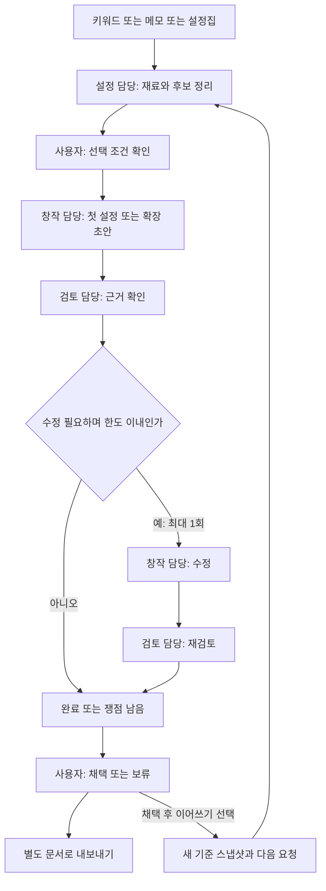

# LoreForge 프로젝트 기획서

작성일: 2026-10-20 · 구현 기간: 2026-10-20~22, Asia/Seoul

상태: 구현 전 기획. 이름은 사용자 확정, OpenAI API 키 보유는 사용자 설명에 근거한다. 아래 기술 설계와 수치 제한은 3일 개발을 위한 초기 제안이며 실제 사용성·성능은 검증 전이다.

## 1. 한 문장 정의

**키워드 몇 개부터 기존 설정집까지, 흩어진 아이디어를 일관된 세계관으로 발전시키는 AI 창작 도구.**

## 2. 문제와 대상 사용자

대상은 소설·웹툰·게임의 스토리와 설정을 직접 만드는 개인 창작자다. 키워드만 떠올린 사용자, 단편적인 메모를 가진 사용자, 이미 설정집이 있는 사용자 모두 같은 입력 흐름으로 시작한다. 강호행은 기존 설정집 활용 사례이며 제품의 필수 시작 조건이 아니다.

초기에는 흩어진 아이디어를 세계의 규칙·인물·갈등으로 연결하는 부담이 있고, 발전 단계에서는 어떤 내용이 단순 제안이고 무엇이 채택한 설정인지 구분하기 어렵다.

설정이 쌓이면 인물관계, 능력의 조건, 인물이 정보를 아는 시점, 사건의 인과관계를 함께 관리해야 한다. 새 아이디어가 흥미롭더라도 이전 설정을 바꾸거나 필요한 설명을 빠뜨릴 수 있다. 한 번의 생성으로 얻은 결과를 창작자가 다시 원문과 대조해야 하는 부담이 핵심 문제다.

발표 도입에는 유명 작품의 사례를 짧게 사용한다. 죠죠는 가족관계 설정의 수정·사과 사례, 드래곤볼은 능력 규칙의 일관성 논쟁, 노블레스는 결말의 설명 부족에 관한 독자 비판으로 구분한다. 작품 비판을 서비스의 실제 효과로 제시하지 않는다. 출처와 한계는 [참고 자료](REFERENCES.md)에 정리했다.

### 해결하려는 작업

- 키워드·메모만으로도 첫 설정 초안을 만들 수 있다.
- 입력 재료, 명시적으로 지킬 조건, AI 제안, 사용자가 채택한 설정을 구분한다.
- 기존 설정을 근거로 새로운 인물·사건·분기를 구체화한다.
- 입력 조건·채택한 설정과의 충돌 또는 초안 내부 모순을 해당 근거와 함께 검토한다. 기준이 부족한 부분은 판단 불가나 질문으로 남긴다.
- AI의 대안을 창작자가 판단하고 채택한 결과를 별도로 보관한다.

### 제품이 주장하지 않을 것

- 모든 설정 오류를 자동으로 찾아내거나 좋은 이야기를 객관적으로 보장한다는 주장.
- 반전·거짓말·인물 성장·의도된 설정 변경을 무조건 오류로 판단하는 기능.
- 작가의 선택 없이 원문을 자동으로 고치거나 AI 제안을 원래 설정으로 승격하는 기능.

## 3. 시작 사례와 실제 적용

### 키워드로 시작하기

공개 예시: **무협 / 기억을 잃는 대가로 강해지는 무공 / 거짓말을 못 하는 주인공**. 별도 설정집이나 확장 요청 없이 입력할 수 있다. 설정 담당은 입력에 있는 재료와 조건만 정리하고, 창작 담당이 세계 규칙·인물·갈등을 포함한 초안 하나를 제안한다. 여러 대안 동시 생성과 긴 질문 인터뷰는 3일 범위에서 제외한다.

검토 담당은 입력 조건과 초안 내부의 모순·설명 부족을 확인한다. 사용자가 결과를 문서 단위로 채택하면 ‘이 설정 이어쓰기’로 다음 요청에 사용할 수 있다. 채택 전에는 초안의 내용을 기존 확정 설정이라고 부르지 않는다.

### 기존 설정집 활용하기

강호행 사례에서 사용자가 지정한 기준 문서는 Google Drive의 **「강호행 스토리 3차 수정본」**이다. 이를 해당 사례의 기준 자료로 삼으며 다른 개정본을 자동으로 합치지 않는다. 원문은 저장소에 포함하지 않는다.

기존 설정집 시연은 **입문 세력에 따라 달라지는 교류전 전후 사건 한 구간**을 구체화한다. 공통 줄거리와 참가 조건을 함께 보존하면서, 다른 경로의 연결이 어떻게 달라져야 하는지 검토한다. 구체적인 원문 제약과 문서 위치는 로컬 참고 자료에만 둔다.

시연에서 보여줄 변화는 글의 길이가 아니라 다음 네 가지다.

1. 입력 재료·보호 조건·채택한 설정 중 무엇을 근거로 사용했는가.
2. 초안에서 어떤 충돌 후보나 설명 부족이 발견됐는가.
3. 수정본이 무엇을 바꿨고, 어떤 질문은 남겨두었는가.
4. 창작자가 어떤 제안을 채택·보류했고 그 이유는 무엇인가.

## 4. 3일 필수 범위와 수용 기준

범위는 **로컬 사용자 1명, 새 작업당 입력 재료 1건, 선택적 요청 1개, 초안 1개, 수정 최대 1회**다. 입력 형식별 별도 화면이나 여러 프로젝트 관리 화면은 만들지 않는다. 작업 이력은 여러 건 저장하며, 채택 결과에서 이어쓰는 다음 작업은 사용자가 직접 시작한다.

| ID | 기능 | 완료를 판단할 조건 |
|---|---|---|
| F1 | 키워드·메모·본문 입력 | 키워드 몇 개만으로 시작 가능하다. 하나의 텍스트 입력창과 선택적 TXT·MD 가져오기를 제공하고 원문·버전·문단 ID를 보존한다. 새 작업의 빈 입력·제한 초과를 설명한다. |
| F2 | 재료·조건 확인 | 입력에서 정리한 후보를 실제 근거와 연결한다. 사용자가 반드시 지킬 조건을 직접 입력하거나 후보에서 선택할 수 있다. 선택은 필수가 아니며 AI 추론은 후보로만 남긴다. |
| F3 | 첫 설정·확장 생성 | 새 입력에서 요청이 비어 있으면 첫 설정 초안 하나를 만들고, 이어쓰기에서는 채택 설정의 다음 사건을 제안한다. 요청이 있으면 그 내용으로 구체화한다. 같은 실행 구조로 입력·선택 조건·채택 설정을 반영하고 새 제안을 구분한다. |
| F4 | 근거별 검토 | 입력 조건·채택 설정과의 충돌에는 해당 기준과 초안 위치를, 내부 모순에는 초안의 대응 위치들을 표시한다. 설명 부족·판단 불가를 구분하고 없는 원문을 인용하지 않는다. |
| F5 | 제한된 수정 루프 | 수정 필요 시 1회 수정하고 재검토한다. 한도 도달을 통과로 처리하지 않는다. 원문·초안·수정본을 보존한다. |
| F6 | 채택·보류·이어쓰기·내보내기 | 결과를 문서 단위로 채택·보류한다. 채택한 최종 결과만 다음 작업의 기준 스냅샷에 포함할 수 있다. 보류 결과는 자동 포함하지 않는다. 원문·이전 기준은 보존하고 근거·남은 쟁점과 함께 내보낸다. |
| F7 | 진행·실패·이력 | 실행 단계, 소요 시간, 호출 수, 토큰을 표시한다. 오류를 성공과 구분하고 재시작 후 완료된 이력과 채택 상태가 유지된다. |
| F8 | 단일 생성 비교 — 보너스 목표 | 기능 완성 후 동일한 초안의 검토 전후를 비교하고 실패를 포함한 모든 실행 결과를 남긴다. 미수행이면 보너스 미검증으로 보고한다. |

입력 제한 초기값은 입력 재료·직접 입력한 보호 조건·이어받는 채택 설정을 합한 기준 본문 20,000자, 파일 100KB, 선택적 요청 2,000자다. 새 입력에서 요청이 비어 있으면 “이 재료로 세계 규칙·인물·갈등의 첫 설정 초안을 만들어줘”를 사용한다. 이어쓰기 요청이 비어 있으면 “채택한 설정을 지키며 다음 사건 하나를 구체화해줘”를 사용한다. 두 경우 모두 실제 요청을 기록한다. 실제 모델의 컨텍스트 한도와 출력 여유를 확인하고 초과 시 잘라서 숨기지 말고 입력을 줄이도록 안내한다. 큰 설정집 전체 처리는 후속 범위다.

### 우선 검증 항목

공개 가상 입력 1건의 LangSmith 추적으로 생성·검토·수정 단계를 확인해 발표 근거를 남긴다. Base 실습에서 강조된 실행 흐름 확인을 반영한 선택이며, 모든 신규 서비스에 모든 기술이 필수라는 해석은 아니다. 추적은 기본 비활성이고 공개 입력 확인에만 켠다. 비공개 강호행 원문은 별도 선택 없이 외부 추적하지 않는다.

### 선택 범위

- 문단별 차이 강조, 검토 필터, 소요 시간 시각화.
- 여유가 있으면 평가 케이스 반복 실행과 결과 집계 화면.

### 이번에 제외

- Google Drive 자동 동기화·원문 쓰기, PDF/HWP/OCR 입력.
- Codex·Claude Code 구독 연동, Ollama 추가 백엔드, 모델 간 경쟁·자동 선택.
- 벡터 DB·임베딩·대용량 RAG, 외부 역사·과학 고증 자동 검색.
- 관계도 편집기, 이미지 생성, 전체 60층 시나리오 생성, 게임 코드 생성.
- 로그인·결제·팀 협업·클라우드 배포·공개 SaaS.

## 5. 사용자 흐름과 화면

재료 입력 → 후보·선택 조건 확인 → 첫 설정 또는 확장 생성 → 검토·수정 → 채택·보류 → 내보내기 또는 채택 설정 이어쓰기.

단일 화면을 세 영역으로 구성한다. 좁은 화면에서는 세로로 배치한다.

- **자료 영역:** “키워드나 설정을 자유롭게 적어주세요” 입력창, 선택적 파일 가져오기·보호 조건, 후보와 근거, 이어받은 채택 설정.
- **작성 영역:** 선택적 요청, 초안·수정본 탭, 진행 상태, 실행 이력.
- **검토 영역:** 분류별 지적, 근거로 이동, 남은 질문, 문서 단위 채택·보류·내보내기, 채택 결과의 “이 설정 이어쓰기”.

원문과 모델 출력을 HTML로 그대로 실행하지 않는다. 텍스트 또는 안전하게 처리한 Markdown으로 표시한다. 로딩·빈 결과·실패 상태를 각각 설명하고 버튼의 비활성 이유를 보여준다.

## 6. 에이전트와 실행 구조

| 역할 | 입력 | 책임과 출력 |
|---|---|---|
| 설정 담당 | 키워드·메모·본문, 이어받은 기준 | 입력에서 확인되는 재료·조건·설정 후보를 구조화한다. 부족한 설정을 이미 존재하는 사실처럼 채우지 않는다. |
| 창작 담당 | 입력·선택 조건·채택 설정·요청 | 첫 설정 또는 확장 초안 하나를 만들고 피드백에 따라 수정한다. 기준 문서를 변경하지 않는다. |
| 검토 담당 | 동일 기준 스냅샷·조건·초안 | 기준과의 충돌·초안 내부 모순·설명 부족·의도 확인 질문을 구분하고 실제 근거 위치를 연결한다. |

세 역할은 별도 프롬프트와 출력 계약을 가진 순차 단계다. 서로 다른 모델이나 병렬 실행이 필수는 아니다. 동일 모델의 오류를 공유할 수 있다는 한계도 평가에 남긴다.

### 기술 선택

- FastAPI·LangGraph·SQLite·Vue 3·SSE의 역할은 수업 Base에서 참고한다. 예제 폴더를 통째로 복사하지 않고 필요한 구조를 선별한다.
- OpenAI Python SDK와 Responses API로 연결하고 Pydantic 기반 구조화 출력을 사용한다. 형식 준수와 이야기 내용의 정확성은 별도 검증 대상이다. [공식 Structured Outputs 문서](https://developers.openai.com/api/docs/guides/structured-outputs?api-mode=responses)
- 모델 ID는 `OPENAI_MODEL`로 관리한다. Day 1에 계정에서 사용 가능한 모델의 한국어 품질·지연·구조화 출력 지원을 확인해 하나를 고정하고 평가에 기록한다. 이 기획 단계에서 특정 모델 이용 권한이나 가격을 가정하지 않는다.
- 입력·조건·명시적으로 이어받은 채택 설정을 묶은 짧은 기준 스냅샷 전체를 생성·검토 단계에 제공한다. 자동 요약만을 유일한 근거로 사용하지 않는다. 초안의 새 설정은 이번 검토에서 기존 기준으로 소급하지 않는다.
- MCP는 **로컬 문단 저장소의 `get_passages(context_version, passage_ids)` 도구 1개**로 제한한다. 입력·보호 조건·채택 설정의 근거를 서버가 이 도구로 재조회해 표시한다. 초안 내부 모순의 위치는 해당 초안 버전에서 직접 검증한다. 모델의 자율 도구 선택이나 벡터 검색을 구현했다고 주장하지 않는다.
- 초기 MCP 도구는 읽기 전용이다. 원문 변경과 채택 저장은 검증된 서버 코드가 처리한다.

### 수업 Base에서 바꿀 부분

| 기존 예제에서 확인한 동작 | LoreForge에서의 결정 |
|---|---|
| 운영 장애 분류·모니터링·런북 조회 | 창작 요청·원문 문단·설정 근거로 교체 |
| 글자 수와 번호 포함 여부 검사 | 근거·분기 조건·정보 시점 중심 검토로 교체 |
| 일정 횟수 실패 후 통과 처리 | 한도 도달 시 `needs_attention`으로 종료 |
| 가상 단가로 비용 표시 | 실제 입력·출력 토큰 표시, 실제 청구액으로 표현하지 않음 |
| 고정 지연·의도적 첫 도구 실패 | 제품 실행에서는 제거, 필요한 실패는 테스트에서 주입 |
| 실행 시 세션 DB 삭제·포트 프로세스 강제 종료 | 상태 보존, 포트 충돌 안내, 자신의 프로세스만 종료 |

## 7. 데이터와 상태의 최소 계약

- `Source`: 입력 원문(키워드·메모·본문), SHA-256 버전, 문단 ID. 원문을 보존하며 편집하면 새 버전을 만든다.
- `Context`: 입력 버전·직접 입력/선택한 조건·이어받은 채택 결과 ID와 본문을 담은 불변 기준 스냅샷. 각 근거 문단에 `input` / `constraint` / `accepted` 출처를 표시한다. 키워드만 있어도 생성할 수 있다.
- `Fact`: 내용, 종류, 근거 문단 ID, 적용 경로·시점, `explicit` 또는 `inferred`, 사용자 보호 여부. AI 추론과 추출 후보는 자동 확정하지 않는다.
- `Run`: 기준 스냅샷 버전, 실제 요청, 모델·프롬프트 버전, 초안, 수정본, 검토 결과, 상태, 호출 수·시간·토큰.
- `Issue`: `conflict_candidate` / `internal_conflict` / `missing_explanation` / `intent_question`, 근거 종류·버전·위치, 이유, 수정 제안, 해결 상태. 외부 기준 충돌은 기준과 초안을, 내부 모순은 초안 내 두 위치를 요구한다. 기준이 없어 확인할 수 없는 내용은 판정 불가로 남기며 “설정 충돌 없음”으로 포괄 보증하지 않는다.
- `Decision`: `pending` / `accepted` / `deferred`, 대상 최종 결과, 선택 이유. 문서 단위 채택이며 개별 사실 편집 UI는 제외한다. 미해결 쟁점이 있으면 채택해도 지우지 않는다.

‘이 설정 이어쓰기’는 서버에서 채택 상태를 확인하고 기존 기준+선택한 최종 결과로 새 스냅샷을 만든다. 수정 전 초안이나 보류 결과를 덧붙이지 않고 기존 스냅샷·이력은 바꾸지 않는다. 새 실행은 이 스냅샷을 고정해서 사용한다. 누적 기준이 입력 제한을 넘으면 자동 요약·누락 대신 범위를 줄이도록 안내한다.

실행 상태는 `running`, `completed`, `needs_attention`, `failed`, `interrupted`로 구분한다. 재시작 시 남아 있는 `running`은 `interrupted`로 표시하고 유료 호출을 자동 재개하지 않는다. 검토 결과가 없거나 출력 파싱이 실패하면 검토 통과가 아니다.

### 예정 인터페이스

- `POST /sources`: 키워드·메모·설정집 입력 등록.
- `POST /sources/{id}/analyze`: 입력 재료·설정 후보 정리.
- `POST /runs`: 입력 ID 또는 이어쓸 채택 결과 ID, 선택 조건·선택적 요청으로 작업 시작. 서버가 기준 스냅샷을 만들고 빈 요청의 기본값을 기록한다.
- `GET /runs/{id}` 및 `GET /runs/{id}/events`: 결과와 SSE 진행 상태 조회.
- `POST /runs/{id}/decision`: 채택·보류 저장.
- `GET /runs/{id}/export`: Markdown 다운로드.

SSE 재연결은 실행을 다시 만들지 않는다. 완료 결과는 GET으로 다시 읽을 수 있게 한다. MVP의 동시 실행은 1건으로 제한하며 중복 실행에는 현재 작업 상태를 안내한다.

## 8. 반복·실패·비용 통제

- 한 작업의 준비 분석 1회, 초안 1회, 검토 1회, 필요할 때 수정 1회+재검토 1회: 정상 흐름 최대 5회 모델 호출. 분석 엔드포인트와 실행 엔드포인트는 같은 작업 예산을 공유하며 재사용 시 분석 비용을 중복 집계하지 않는다. 이어쓰기는 사용자가 시작한 새 작업으로 별도 기록한다.
- 자동 재시도는 실행 전체에서 1회만 허용하며 총 호출 시도 상한은 6회다. SDK 내부 자동 재시도와 중복되지 않게 설정한다.
- 429·일시적 5xx에만 남은 재시도 예산을 쓴다. 인증·권한·입력 오류, 거절·불완전 출력은 설명하고 종료한다. 응답 여부가 불명확한 타임아웃은 자동 중복 호출하지 않는다.
- 초기 제한: 요청별 120초, 전체 실행 10분. 호출 횟수·출력 한도와 함께 Day 1 실측으로 조정하고 변경을 기록한다.
- API 키는 서버의 `.env`/환경변수에만 둔다. 문서 본문은 사용자가 실행한 작업을 위해 OpenAI API에 전달되며 입력 화면에서 이를 알린다. 여기서 말하는 로컬 앱은 로컬 추론을 뜻하지 않는다.
- 모델 토큰 집계는 실제 응답의 usage를 사용한다. 비용을 표시한다면 확인 날짜가 있는 입력·출력 단가와 계산식을 명시하고 추정치로 표시한다. 초기 MVP는 금액보다 토큰·호출 수·시간을 우선한다.
- 문서 안의 지시는 설정 자료로 처리하고 실행 권한으로 사용하지 않는다. 임의 셸 실행·외부 페이지 탐색·원문 쓰기 도구는 제공하지 않는다.

## 9. 완료 기준과 한계

필수 F1~F7을 실제 서비스로 확인하고 [평가 계획](EVALUATION.md)의 기능 검사를 수행한다. F8의 같은 초안 비교는 과제 보너스 목표이며 핵심 기능 안정화 뒤에 수행한다. 공개 입력 LangSmith 추적은 우선 검증 항목으로 시도 결과와 실패·미실행 여부를 남긴다. 원문 불변·근거 유효성·반복 상한·저장 복원은 코드 검증 대상이고, 이야기의 자연스러움과 창작 의도는 사용자의 판단 대상이다.

성공의 최소 조건은 키워드만으로 첫 설정을 생성·검토·채택하고 한 번 이어쓸 수 있으며, 기존 설정집 입력도 같은 흐름으로 끝까지 사용할 수 있고 실패를 숨기지 않는 것이다. 품질 향상은 실측 결과로 판단하며 개선되지 않았다면 그 결과와 추가 지연·토큰 비용도 발표한다. 특정 작가의 작품 전체를 평가할 수 있다거나 범용 고증 도구가 완성됐다고 주장하지 않는다.
