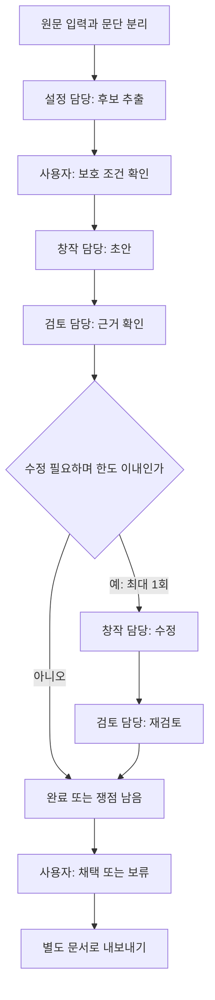

# LoreForge 프로젝트 기획서

작성일: 2026-10-20 · 구현 기간: 2026-10-20~22, Asia/Seoul

상태: 구현 전 기획. 이름은 사용자 확정, OpenAI API 키 보유는 사용자 설명에 근거한다. 아래 기술 설계와 수치 제한은 3일 개발을 위한 초기 제안이며 실제 사용성·성능은 검증 전이다.

## 1. 한 문장 정의

**창작자가 뿌리 스토리를 확장하면서 기존 설정과 창작 의도를 유지하도록, 역할별 AI가 생성·검토·수정하고 근거와 대안을 제공하는 세계관 제작실.**

## 2. 문제와 대상 사용자

대상은 소설·웹툰·게임의 스토리와 설정을 직접 만드는 개인 창작자다. 첫 사용자는 강호행 게임의 기획자이며 첫 작업은 기존 뿌리 스토리의 분기 구체화다.

설정이 쌓이면 인물관계, 능력의 조건, 인물이 정보를 아는 시점, 사건의 인과관계를 함께 관리해야 한다. 새 아이디어가 흥미롭더라도 이전 설정을 바꾸거나 필요한 설명을 빠뜨릴 수 있다. 한 번의 생성으로 얻은 결과를 창작자가 다시 원문과 대조해야 하는 부담이 핵심 문제다.

발표 도입에는 유명 작품의 사례를 짧게 사용한다. 죠죠는 가족관계 설정의 수정·사과 사례, 드래곤볼은 능력 규칙의 일관성 논쟁, 노블레스는 결말의 설명 부족에 관한 독자 비판으로 구분한다. 작품 비판을 서비스의 실제 효과로 제시하지 않는다. 출처와 한계는 [참고 자료](REFERENCES.md)에 정리했다.

### 해결하려는 작업

- 확정된 설정과 아직 결정하지 않은 부분을 구분한다.
- 기존 설정을 근거로 새로운 인물·사건·분기를 구체화한다.
- 충돌 가능성과 설명이 필요한 연결을 원문 근거와 함께 검토한다.
- AI의 대안을 창작자가 판단하고 채택한 결과를 별도로 보관한다.

### 제품이 주장하지 않을 것

- 모든 설정 오류를 자동으로 찾아내거나 좋은 이야기를 객관적으로 보장한다는 주장.
- 반전·거짓말·인물 성장·의도된 설정 변경을 무조건 오류로 판단하는 기능.
- 작가의 선택 없이 원문을 자동으로 고치거나 AI 제안을 원래 설정으로 승격하는 기능.

## 3. 첫 적용 사례와 시연 작업

사용자가 지정한 기준 문서는 Google Drive의 **「강호행 스토리 3차 수정본」**이다. 이를 현재 뿌리 스토리로 삼으며 다른 개정본을 자동으로 합치지 않는다. 원문은 저장소에 포함하지 않는다.

첫 시연은 **입문 세력에 따라 달라지는 교류전 전후 사건 한 구간**을 구체화한다. 공통 줄거리와 참가 조건을 함께 보존하면서, 다른 경로의 연결이 어떻게 달라져야 하는지 검토한다. 구체적인 원문 제약과 문서 위치는 로컬 참고 자료에만 둔다.

시연에서 보여줄 변화는 글의 길이가 아니라 다음 네 가지다.

1. 원문의 어떤 조건을 사용했는가.
2. 초안에서 어떤 충돌 후보나 설명 부족이 발견됐는가.
3. 수정본이 무엇을 바꿨고, 어떤 질문은 남겨두었는가.
4. 창작자가 어떤 제안을 채택·보류했고 그 이유는 무엇인가.

## 4. 3일 필수 범위와 수용 기준

범위는 **로컬 사용자 1명, 작업당 원문 1개, 확장 요청 1개, 초안 1개, 수정 최대 1회**다. 여러 프로젝트 관리 화면은 만들지 않는다. 작업 이력은 여러 건 저장할 수 있다.

| ID | 기능 | 완료를 판단할 조건 |
|---|---|---|
| F1 | 텍스트·TXT·MD 입력 | UTF-8 원문을 보존하고 원문 버전·문단 ID를 만든다. 빈 입력·초기 제한 초과를 설명한다. |
| F2 | 설정 후보 확인 | 인물·세력·규칙·사건·정보 공개 시점의 후보가 근거 문단과 연결된다. 사용자가 후보를 제외하거나 보호 조건으로 선택할 수 있다. |
| F3 | 확장안 생성 | 확장 요청과 선택한 보호 조건을 반영한 초안을 만든다. 새로 제안한 내용을 기존 설정과 구분한다. |
| F4 | 근거 기반 검토 | 지적마다 원문 문단과 초안 위치, 분류, 이유를 표시한다. 판단 불가도 결과로 허용한다. |
| F5 | 제한된 수정 루프 | 수정 필요 시 1회 수정하고 재검토한다. 한도 도달을 통과로 처리하지 않는다. 원문·초안·수정본을 보존한다. |
| F6 | 채택·보류·내보내기 | 문서 단위로 채택 또는 보류하고 근거·남은 쟁점을 포함한 Markdown을 내려받는다. 원문에 자동 병합하지 않는다. |
| F7 | 진행·실패·이력 | 실행 단계, 소요 시간, 호출 수, 토큰을 표시한다. 오류를 성공과 구분하고 재시작 후 완료된 이력과 채택 상태가 유지된다. |
| F8 | 단일 생성 비교 | 같은 입력으로 검토 없는 초안과 루프 결과를 비교하고 모든 실행 결과를 남긴다. |

입력 제한 초기값은 원문 20,000자·파일 100KB·확장 요청 2,000자다. 실제 모델의 컨텍스트 한도와 출력 여유를 확인하고 초과 시 잘라서 숨기지 말고 입력을 줄이도록 안내한다. 큰 설정집 전체 처리는 후속 범위다.

### 선택 범위

- 문단별 차이 강조, 검토 필터, 소요 시간 시각화.
- 여유가 있으면 평가 케이스 반복 실행과 결과 집계 화면.
- 공개용 가상 설정을 이용한 LangSmith 추적. 실제 원문 외부 추적은 별도 선택.

### 이번에 제외

- Google Drive 자동 동기화·원문 쓰기, PDF/HWP/OCR 입력.
- Codex·Claude Code 구독 연동, Ollama 추가 백엔드, 모델 간 경쟁·자동 선택.
- 벡터 DB·임베딩·대용량 RAG, 외부 역사·과학 고증 자동 검색.
- 관계도 편집기, 이미지 생성, 전체 60층 시나리오 생성, 게임 코드 생성.
- 로그인·결제·팀 협업·클라우드 배포·공개 SaaS.

## 5. 사용자 흐름과 화면

입력 → 설정 후보 확인 → 요청 실행 → 결과 비교 → 채택·보류 → 내보내기.

단일 화면을 세 영역으로 구성한다. 좁은 화면에서는 세로로 배치한다.

- **자료 영역:** 원문, 문단 번호, 설정 후보, 보호 조건.
- **작성 영역:** 확장 요청, 초안·수정본 탭, 진행 상태, 실행 이력.
- **검토 영역:** 분류별 지적, 근거로 이동, 남은 질문, 채택·보류, 내보내기.

원문과 모델 출력을 HTML로 그대로 실행하지 않는다. 텍스트 또는 안전하게 처리한 Markdown으로 표시한다. 로딩·빈 결과·실패 상태를 각각 설명하고 버튼의 비활성 이유를 보여준다.

## 6. 에이전트와 실행 구조

| 역할 | 입력 | 책임과 출력 |
|---|---|---|
| 설정 담당 | 원문 문단 | 근거가 있는 설정 후보, 적용 조건, 미정 사항을 구조화한다. 추론을 확정 사실로 만들지 않는다. |
| 창작 담당 | 원문·보호 조건·요청 | 초안을 생성하고 검토 피드백에 따라 수정한다. 원문은 변경하지 않는다. |
| 검토 담당 | 동일 원문·조건·초안 | 충돌 후보·설명 부족·의도 확인 질문을 분리한다. 지적과 원문 근거를 연결한다. |

세 역할은 별도 프롬프트와 출력 계약을 가진 순차 단계다. 서로 다른 모델이나 병렬 실행이 필수는 아니다. 동일 모델의 오류를 공유할 수 있다는 한계도 평가에 남긴다.

### 기술 선택

- FastAPI·LangGraph·SQLite·Vue 3·SSE의 역할은 수업 Base에서 참고한다. 예제 폴더를 통째로 복사하지 않고 필요한 구조를 선별한다.
- OpenAI Python SDK와 Responses API로 연결하고 Pydantic 기반 구조화 출력을 사용한다. 형식 준수와 이야기 내용의 정확성은 별도 검증 대상이다. [공식 Structured Outputs 문서](https://developers.openai.com/api/docs/guides/structured-outputs?api-mode=responses)
- 모델 ID는 `OPENAI_MODEL`로 관리한다. Day 1에 계정에서 사용 가능한 모델의 한국어 품질·지연·구조화 출력 지원을 확인해 하나를 고정하고 평가에 기록한다. 이 기획 단계에서 특정 모델 이용 권한이나 가격을 가정하지 않는다.
- 짧은 원문 전체를 모든 생성·검토 단계에 제공한다. 핵심 설정이 검색 누락으로 사라지는 문제를 피하고, 추출된 요약만을 유일한 근거로 사용하지 않는다.
- MCP는 **로컬 문단 저장소의 `get_passages(source_version, passage_ids)` 도구 1개**로 제한한다. 검토 담당이 제시한 문단을 서버가 이 도구로 재조회해 실제 근거 문장을 표시한다. 모델의 자율 도구 선택이나 벡터 검색을 구현했다고 주장하지 않는다.
- 초기 MCP 도구는 읽기 전용이다. 원문 변경과 채택 저장은 검증된 서버 코드가 처리한다.

### 수업 Base에서 바꿀 부분

| 기존 예제에서 확인한 동작 | LoreForge에서의 결정 |
|---|---|
| 운영 장애 분류·모니터링·런북 조회 | 창작 요청·원문 문단·설정 근거로 교체 |
| 글자 수와 번호 포함 여부 검사 | 근거·분기 조건·정보 시점 중심 검토로 교체 |
| 일정 횟수 실패 후 통과 처리 | 한도 도달 시 `needs_attention`으로 종료 |
| 가상 단가로 비용 표시 | 실제 입력·출력 토큰 표시, 실제 청구액으로 표현하지 않음 |
| 고정 지연·의도적 첫 도구 실패 | 제품 실행에서는 제거, 필요한 실패는 테스트에서 주입 |
| 실행 시 세션 DB 삭제·포트 프로세스 강제 종료 | 상태 보존, 포트 충돌 안내, 자신의 프로세스만 종료 |

## 7. 데이터와 상태의 최소 계약

- `Source`: 원문, SHA-256 버전, 문단 ID와 문장. 편집하면 새 버전을 만든다.
- `Fact`: 내용, 종류, 근거 문단 ID, 적용 경로·시점, `explicit` 또는 `inferred`, 사용자 보호 여부. 추출은 후보이고 사용자 확인 전 확정된 설정 목록이라고 부르지 않는다.
- `Run`: 원문 버전, 요청, 보호 조건, 모델·프롬프트 버전, 초안, 수정본, 검토 결과, 상태, 호출 수·시간·토큰.
- `Issue`: `conflict_candidate` / `missing_explanation` / `intent_question`, 원문 근거, 초안 위치, 이유, 수정 제안, 해결 상태.
- `Decision`: `pending` / `accepted` / `deferred`, 대상 결과, 선택 이유. 채택은 원문 변경과 다르다.

실행 상태는 `running`, `completed`, `needs_attention`, `failed`, `interrupted`로 구분한다. 재시작 시 남아 있는 `running`은 `interrupted`로 표시하고 유료 호출을 자동 재개하지 않는다. 검토 결과가 없거나 출력 파싱이 실패하면 검토 통과가 아니다.

### 예정 인터페이스

- `POST /sources`: 원문 등록.
- `POST /sources/{id}/analyze`: 설정 후보 추출.
- `POST /runs`: 보호 조건·요청·실행 모드로 작업 시작.
- `GET /runs/{id}` 및 `GET /runs/{id}/events`: 결과와 SSE 진행 상태 조회.
- `POST /runs/{id}/decision`: 채택·보류 저장.
- `GET /runs/{id}/export`: Markdown 다운로드.

SSE 재연결은 실행을 다시 만들지 않는다. 완료 결과는 GET으로 다시 읽을 수 있게 한다. MVP의 동시 실행은 1건으로 제한하며 중복 실행에는 현재 작업 상태를 안내한다.

## 8. 반복·실패·비용 통제

- 설정 추출 1회, 초안 1회, 검토 1회, 필요할 때 수정 1회+재검토 1회: 정상 흐름 최대 5회 모델 호출.
- 자동 재시도는 실행 전체에서 1회만 허용하며 총 호출 시도 상한은 6회다. SDK 내부 자동 재시도와 중복되지 않게 설정한다.
- 429·일시적 5xx에만 남은 재시도 예산을 쓴다. 인증·권한·입력 오류, 거절·불완전 출력은 설명하고 종료한다. 응답 여부가 불명확한 타임아웃은 자동 중복 호출하지 않는다.
- 초기 제한: 요청별 120초, 전체 실행 10분. 호출 횟수·출력 한도와 함께 Day 1 실측으로 조정하고 변경을 기록한다.
- API 키는 서버의 `.env`/환경변수에만 둔다. 문서 본문은 사용자가 실행한 작업을 위해 OpenAI API에 전달되며 입력 화면에서 이를 알린다. 여기서 말하는 로컬 앱은 로컬 추론을 뜻하지 않는다.
- 모델 토큰 집계는 실제 응답의 usage를 사용한다. 비용을 표시한다면 확인 날짜가 있는 입력·출력 단가와 계산식을 명시하고 추정치로 표시한다. 초기 MVP는 금액보다 토큰·호출 수·시간을 우선한다.
- 문서 안의 지시는 설정 자료로 처리하고 실행 권한으로 사용하지 않는다. 임의 셸 실행·외부 페이지 탐색·원문 쓰기 도구는 제공하지 않는다.

## 9. 완료 기준과 한계

F1~F8을 실제 서비스로 확인하고, [평가 계획](EVALUATION.md)의 기능 검사와 같은 입력 비교를 수행한다. 원문 불변·근거 유효성·반복 상한·저장 복원은 코드 검증 대상이고, 이야기의 자연스러움과 창작 의도는 사용자의 판단 대상이다.

성공의 최소 조건은 작은 원문에서 끝까지 사용할 수 있고 실패를 숨기지 않는 것이다. 품질 향상은 실측 결과로 판단하며 개선되지 않았다면 그 결과와 추가 지연·토큰 비용도 발표한다. 특정 작가의 작품 전체를 평가할 수 있다거나 범용 고증 도구가 완성됐다고 주장하지 않는다.
